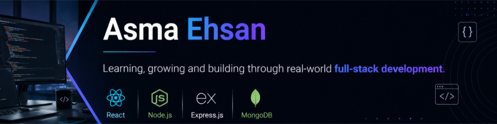

<!-- Accent color used everywhere: #2F81F7 (blue). Portfolio link: add a badge below once your site is ready. -->

<h2>Hi 👋, I'm Asma Ehsan</h2>

 

---

## 🚀 About Me

I'm a **BSIT (Post ADP)** graduate from the **University of Education, Lahore**, specializing in full-stack development with the **MERN stack** (MongoDB, Express.js, React.js, Node.js).

- 🌱 Currently a **MERN Stack Fellow at Dev Weekends**, developing and deploying full-stack applications
- 🛒 Building role-based e-commerce platforms and real estate marketplaces with secure **JWT/cookie authentication**, multi-parameter search, and **Stripe** payments with asynchronous webhooks
- 🎨 Building reusable, component-driven UIs with React, Redux Toolkit, and mobile-first layouts, applying **Human-Computer Interaction (HCI)** principles
- 🧩 Solving problems in **C++** on LeetCode (**44+ problems solved**)

---

## 💼 Experience

| Role | Organization | Period |
| --- | --- | --- |
| **MERN Stack Fellow** | Dev Weekends | Present |
| **Front End Web Developer Intern** | U Devs | Jun 01 – Aug 15, 2025 |

## 🎓 Education

**BSIT (Post ADP)** — University of Education, Lahore

---

## 🛠️ Tech Stack

 

| | |
| --- | --- |
| **Languages** | JavaScript (ES6+), C++ |
| **Frontend** | React.js, Redux Toolkit, Tailwind CSS, Bootstrap, HTML5/CSS3 |
| **Backend** | Node.js, Express.js, REST APIs, JWT & OAuth, OTP Verification |
| **Databases & Tools** | MongoDB Atlas, Mongoose, Firebase, Git/GitHub, Postman, Vercel, Stripe APIs, PayPal, Cloudinary |
| **Core Concepts** | Object-Oriented Programming (OOP), Data Structures, Human-Computer Interaction (HCI) |

---

## ⭐ Featured Project

### 🛒 MultiVendor

A role-based multi-vendor e-commerce platform with secure authentication and Stripe payment integration.

**Tech:** JavaScript · React · Node.js · Express.js · MongoDB · Stripe

---

## 📊 GitHub Stats

 

---

## 🧠 LeetCode

---

## 🐍 Contribution Snake

<picture>
  <source media="(prefers-color-scheme: dark)" srcset="https://raw.githubusercontent.com/Asma-Ehsan/Asma-Ehsan/output/github-snake-dark.svg" />
  <source media="(prefers-color-scheme: light)" srcset="https://raw.githubusercontent.com/Asma-Ehsan/Asma-Ehsan/output/github-snake.svg" />
  
</picture>

---

## 🤝 Connect With Me

